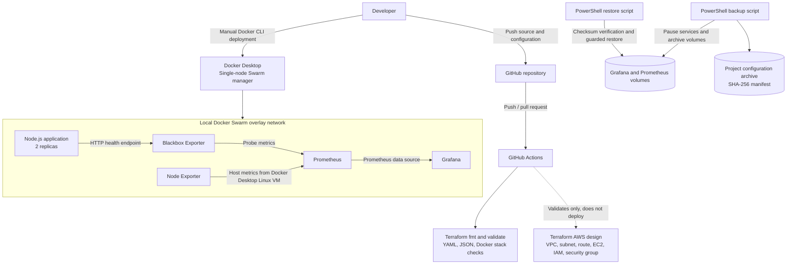

# Enterprise Cloud Infrastructure & DevOps Automation

## 1. Project Status and Scope

This project was developed for the Cognevance Cloud Computing & DevOps Internship.

The completed implementation is a **local Docker Swarm proof of concept** running on Docker Desktop. Terraform contains an AWS infrastructure design that has passed local formatting and configuration validation, but **no AWS resources have been provisioned**.

The current local environment is a single Docker Desktop Swarm node. It demonstrates service orchestration, replicas, monitoring, and recovery scripting, but it is not a multi-host or production high-availability cluster.

## 2. Architecture Diagram

The diagram separates the AWS design from the local environment actually deployed.

## 3. Component Inventory

| Component | Technology | Current role | Deployment status |
|---|---|---|---|
| Cloud infrastructure design | AWS and Terraform | Defines proposed VPC, subnet, internet gateway, routes, EC2 nodes, IAM and security groups | Validated locally; not applied |
| Container orchestration | Docker Swarm | Runs the local application and monitoring services | Running on one Docker Desktop node |
| Application | Node.js container from Docker Hub | Exposes the /health endpoint on port 3000 | 2 replicas running |
| Metrics collection | Prometheus | Scrapes Prometheus, Node Exporter, and Blackbox Exporter | Running locally |
| HTTP probe | Blackbox Exporter | Probes the application health endpoint | Running locally |
| Host metrics | Node Exporter | Exposes metrics from the Docker Desktop Linux environment | Running locally |
| Dashboard | Grafana | Uses Prometheus as its data source and provisions the Enterprise Infrastructure Overview dashboard | Running locally |
| CI validation | GitHub Actions | Validates Terraform, YAML, JSON, and Docker Swarm configuration | Successful workflow runs |
| Backup and restore | PowerShell and Docker CLI | Archives monitoring volumes and project configuration; verifies hashes before restore | Scripts implemented; local execution test pending |

## 4. Local Service Topology

The Docker Swarm stack is defined in **docker/swarm/stack.yml**.

| Service | Desired replicas | Published port | Purpose |
|---|---:|---:|---|
| cognevance_app | 2 | Host 80 to container 3000 | Demonstration application |
| cognevance_prometheus | 1 | Internal 9090 | Metrics database and query engine |
| cognevance_blackbox-exporter | 1 | Internal 9115 | HTTP availability probes |
| cognevance_node-exporter | 1 global task | Internal 9100 | Host metrics |
| cognevance_grafana | 1 | Host 3000 to container 3000 | Monitoring dashboard |

All services join the monitoring overlay network. Prometheus and Grafana use named volumes for persistent monitoring data. Grafana administrator credentials are supplied through the external Docker Swarm secret named grafana_admin_password, not stored in the repository.

The stack was verified with docker stack config, and the services were observed running with the expected replica counts. The application health endpoint returned healthy. Grafana displayed the application probe, Prometheus target, and CPU panels.

## 5. CI Validation Workflow

The workflow in **.github/workflows/ci-cd.yml** runs on pushes to main, pull requests targeting main, and manual dispatch.

It checks:

1. Terraform formatting.
2. Terraform initialization without a remote backend.
3. Terraform configuration validation.
4. YAML syntax for workflow, Swarm, and monitoring files.
5. JSON syntax for the Grafana dashboard.
6. Docker Swarm stack configuration.

**Scope clarification:** This is a configuration validation workflow. It does not publish a new application image and does not perform an automatic deployment to AWS or Docker Swarm. The local stack is deployed manually with Docker CLI commands.

## 6. AWS Terraform Design

The Terraform configuration is organized into reusable network and compute modules.

The network module defines:
- A VPC with DNS support and hostnames enabled.
- A public subnet.
- An internet gateway.
- A public route table and subnet association.

The compute module defines:
- An Amazon Linux EC2 manager and configurable worker instances.
- A security group with HTTP access and node-to-node Docker Swarm traffic.
- Optional SSH ingress restricted to a supplied administrator CIDR.
- IAM roles and instance profiles.
- Systems Manager access for manager and worker instances.
- A SecureString parameter used to pass the worker join token from the manager to workers.
- Encrypted gp3 root volumes and IMDSv2 token enforcement.

This is an infrastructure design only. It has not been applied to an AWS account, and no claim of a live AWS deployment is made.

## 7. Backup and Restore Design

**scripts/backup.ps1** creates a timestamped backup folder under backups/ by default. It:

1. Checks for the expected Grafana and Prometheus Swarm services.
2. Records their existing replica counts.
3. Scales both monitoring services to zero to reduce write activity during volume capture.
4. Archives the stack's Grafana and Prometheus named volumes.
5. Archives project source/configuration files while excluding Terraform state, provider caches, local backup output, credentials, and private keys.
6. Writes a manifest with artifact SHA-256 hashes.
7. Restores the original monitoring service replica counts in a finally block.

**scripts/restore.ps1**:
- Requires a backup folder and the -ConfirmRestore switch.
- Validates the manifest, stack name, required artifacts, and SHA-256 hashes.
- Refuses to overwrite volumes while services from the target stack still exist.
- Requires the operator to type RESTORE before replacing volume contents.
- Restores the two named volumes.

Docker Swarm secrets are intentionally not exported. The external grafana_admin_password secret must be available separately when the stack is redeployed. The project-configuration ZIP is a supplementary archive and is not automatically extracted by the restore script.

**Testing status:** The scripts are implemented. A successful backup and restore execution has not yet been recorded as evidence in this repository.

## 8. Security Considerations

- Grafana's administrator password is provided through a Docker Swarm secret.
- The secret value is not written to the repository or backup archive.
- Terraform state, plans, local variables, and provider caches are excluded from source control.
- The Terraform design uses IAM roles and limits optional SSH ingress to a supplied CIDR.
- The local stack publishes the application and Grafana ports on the Docker Desktop host. Keep the environment on a trusted machine/network and do not expose these ports through a router or public firewall.
- The AWS Terraform design and deployment script have not been exercised against a live AWS account.

## 9. Performance and Scalability

The local application is configured with two Swarm replicas, a health check, restart policy, controlled update behavior, and rollback configuration. Prometheus collects CPU metrics exposed by Node Exporter.

The demonstration does not include a multi-node scaling benchmark, load test, autoscaling policy, or multi-host failure test. The two application replicas run on the same Docker Desktop node, so they demonstrate service replication but not host-level fault tolerance.

## 10. Known Limitations and Future Work

- Provision and test the Terraform AWS design only after reviewing costs and access controls.
- Extend the local Swarm proof of concept to multiple hosts if cluster-level availability must be demonstrated.
- Add an automated deployment stage if a real deployment target is introduced.
- Add centralized application/container log aggregation; the current monitoring stack focuses on metrics and health probes.
- Execute and document backup/restore tests.
- Add final screenshots and a completed project report to docs/.
